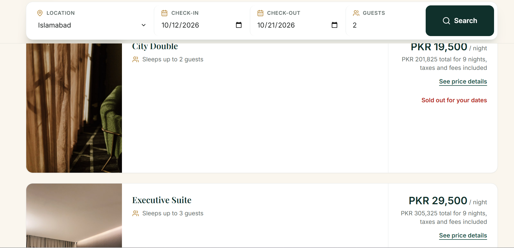
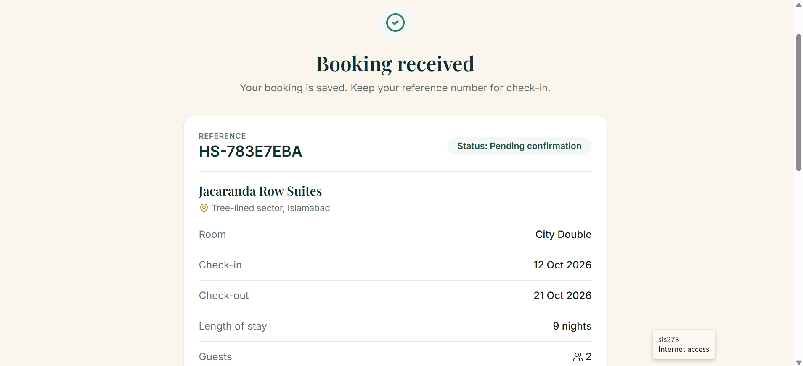

# HavenStay: Boutique Hotel Booking Platform

A hotel booking website for boutique stays in Hunza, Skardu and Islamabad. Guests can search and filter stays, check a price breakdown, create an account, book a room and manage their bookings, while the database itself enforces the booking rules.

**Live demo:** https://havenstay-hotel.netlify.app






## Features

- Search stays by destination, dates and number of guests
- Filter by price per night, guest rating and free cancellation, and sort by best rated or price
- Hotel pages with room options, availability for the chosen dates and a price breakdown
- Sign up and sign in with Supabase Auth
- Booking flow with a confirmation page and reference number
- My bookings page showing each guest's own bookings
- Cancel a booking, allowed only for free-cancellation hotels and before the hotel's deadline
- Double-booking prevention enforced at database level

## Tech Stack

- **Frontend:** React (Vite), Tailwind CSS, React Router, Lucide React
- **Backend and database:** Supabase (Postgres, Auth, Row Level Security)
- **Hosting:** Netlify

## Database-Level Booking Rules

Booking rules live in the database, so they hold no matter what the frontend sends.

| Rule | How it is enforced |
| --- | --- |
| Valid dates and guest counts | Check constraints |
| No overlapping bookings for the same room | Exclusion constraint |
| Capacity, past dates and final price | Trigger (price is calculated on the server) |
| Guests can only see their own bookings | Row Level Security policies |
| Availability across all guests | Security-definer database functions |
| Cancellation only within the hotel's policy | `cancel_booking()` database function |

## Run Locally

**Requirements:** Node.js 18 or newer and a free [Supabase](https://supabase.com) project.

1. Clone the repository and install dependencies:
   ```bash
   git clone https://github.com/galaxyshine701/havenstay.git
   cd havenstay
   npm install
   ```
2. Copy `.env.example` to `.env` and add your Supabase project URL and anon public key.
3. In the Supabase SQL Editor, run `schema.sql` and then `seed.sql` from the `supabase/` folder.
4. For local testing, turn off email confirmation in Supabase under Authentication settings.
5. Start the app:
   ```bash
   npm run dev
   ```

## Sample Data

The app ships with nine fictional hotels and 23 rooms. Ratings, reviews and prices are sample data, and photos are from Unsplash. The design is original.

## Project Structure

```
src/
  components/   reusable UI components
  pages/        home, results, hotel details, booking, confirmation, my bookings, sign in
  hooks/        custom React hooks
  context/      shared app state
  lib/          Supabase client, filters, pricing and cancellation helpers
supabase/       database schema, seed data and cancellation patch
scripts/        utility scripts
```

## Author

Anam Zubair | [GitHub](https://github.com/galaxyshine701) | [LinkedIn](https://www.linkedin.com/in/anam-zubair-bb1638282)
